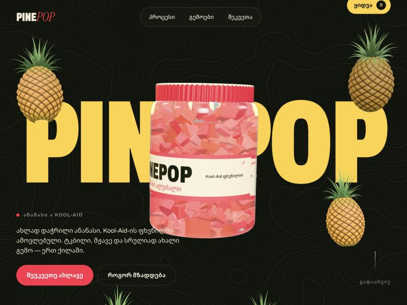
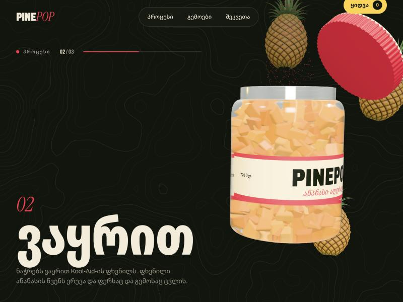
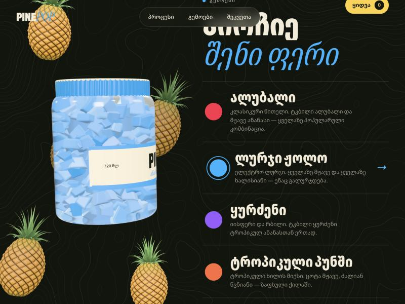
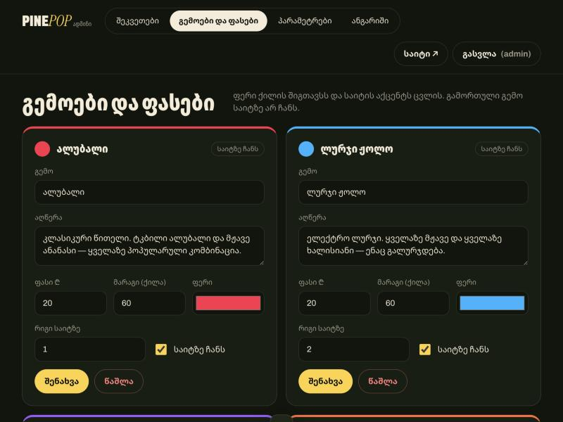

<div align="center">

# PINE*POP* 🍍

Fresh-cut pineapple tossed in Kool-Aid powder, sold by the jar — a one-page Georgian shop
where a 3D glass jar tells the whole story as you scroll.

ქართული  ·  Three.js  ·  GSAP + Lenis  ·  Node.js + Express 5  ·  SQLite (`node:sqlite`)  ·  Vite

[Screenshots](#screenshots) · [Quick start](#quick-start) · [Admin panel](#the-admin-panel) · [Roadmap](PLAN.md)



</div>

---

> **Work in progress.** The site, the order flow, the database and the admin panel all work;
> online card payments, the logo and deployment are still ahead — see [PLAN.md](PLAN.md).
> *Kool-Aid* is a registered trademark of Kraft Heinz. It appears here only as an ingredient;
> the brand is PINEPOP, and nothing in the code hardcodes even that — it is a setting.

PINEPOP is a small food business with a big-studio website. The visual language borrows from
two very different references: the single morphing glass object of
[polpharmabiologics.com](https://www.polpharmabiologics.com/) and the oversized type,
topographic lines and kinetic marquees of [landonorris.com](https://landonorris.com/).

There are no 3D model files in this repository. The jar, its label, the screw lid, every
pineapple chunk inside it and every whole pineapple floating around it are built from code
at load time.

Everything a shop owner would change — the name, the flavours, prices, stock, jar size, shelf
life, delivery cities, fee and time, phone and social links — is edited from a password-protected
admin panel and read from the database. None of it lives in the HTML.

---

## Contents

- [Screenshots](#screenshots)
- [What's on the page](#whats-on-the-page)
- [Quick start](#quick-start)
- [The admin panel](#the-admin-panel)
- [How the 3D works](#how-the-3d-works)
- [Orders and money](#orders-and-money)
- [API](#api)
- [The data model](#the-data-model)
- [Security](#security)
- [Project structure](#project-structure)
- [Known limits](#known-limits)

---

## Screenshots

| | |
| --- | --- |
|  |  |
| **The process.** Scroll drives it: the lid lifts, fresh yellow chunks drop in, powder falls and the chunks change colour, the lid closes. | **Flavours.** Picking one recolours the chunks, the lid, the label and the accent of the whole page. |
|  |  |
| **Admin.** Flavours, prices, stock and colours; orders; site settings; login and password. | **Hero.** The jar sits in front of the giant wordmark and follows the mouse. |

---

## What's on the page

| Section | What happens |
| --- | --- |
| **Loader** | Counter and wordmark while fonts load and shaders compile, then a wipe into the hero. |
| **Hero** | Giant wordmark behind the jar, floating pineapples, mouse-follow tilt. |
| **Statement** | A sentence lights up word by word, a hand-drawn line draws itself, stats count up. |
| **Process** | A pinned, scroll-scrubbed three-step story: cut → sprinkle → seal. |
| **Marquee** | Two rows of type whose speed and direction follow your scroll velocity. |
| **Flavours** | Pick a flavour; the 3D jar and the page accent change colour. |
| **Shop** | Quantity per flavour, live total, delivery line, buy button → checkout drawer. |
| **Footer** | Wordmark, contacts and social links (only the ones that are filled in). |

The jar travels between sections — centre, right, left — while the pineapples gather on its
side so the text side stays readable. Phones get their own poses and a lighter scene.

---

## Quick start

**You need** Node 22.13 or newer (built and tested on Node 26 — the database is Node's built-in
`node:sqlite`, so there is nothing native to compile).

```bash
git clone https://github.com/tornikepe/pinepop.git
cd pinepop
npm install
cp .env.example .env
```

Open `.env` and set `ADMIN_PASSWORD` (8+ characters). Then:

```bash
npm run dev
```

The shop is at `http://localhost:3000`, the admin panel at `/admin`. One process serves both:
Express runs the API and mounts Vite in middleware mode, so hot reload works for the front end.

The database file, `data/pinepop.db`, is created on the first start and filled with four
flavours. Delete it to start over.

**Production**

```bash
npm run build
npm start
```

`npm start` serves the built `dist/` and the API from the same Express server.

---

## The admin panel

`/admin` — sign in with a login and password.

**The first account** is created from `ADMIN_USER` / `ADMIN_PASSWORD` in `.env`, once, on the
first start with an empty `admins` table. After that `.env` is no longer read for it: the login
and password are changed in the panel under **ანგარიში**, and the password is stored as a
scrypt hash.

| Tab | What you can do |
| --- | --- |
| **შეკვეთები** — Orders | Every order with customer, address, items and total; change status (new → confirmed → delivered / cancelled). |
| **გემოები და ფასები** — Flavours | Name, description, price, stock, colour (it tints the 3D jar), order on the page, show/hide, add new. A flavour that already has orders can be hidden but not deleted. |
| **პარამეტრები** — Settings | Brand name (bold + italic part), jar size, shelf life, delivery cities / fee / time, phone & WhatsApp, Facebook, TikTok, Instagram. Empty contact fields are simply not shown. |
| **ანგარიში** — Account | Change login and password. A new password signs out every other device. |

Changes appear on the site on the next page load.

---

## How the 3D works

All of it is in `src/scene/`, plain Three.js, no loaders.

- **The jar** (`jar.js`) is a lathed profile with a physically based glass material
  (transmission, IOR 1.5, clearcoat). The label is a canvas texture redrawn whenever the
  flavour, the brand or the jar size changes. The lid is a cylinder with a knurled edge pushed
  out of its vertices.
- **The chunks** are one `InstancedMesh` of bevelled wedges — several hundred of them in a
  single draw call. Each has its own drop-in timing, so the jar can empty and refill
  bottom-up, and its own share of powder coating, so the colour shift looks uneven and real.
- **The powder** is a point cloud that spirals down into the open jar during step two.
- **The pineapples** (`pineapple.js`) are a lathed body whose surface is pushed out in a spiral
  diamond lattice (the "eyes"), vertex-coloured, with a crown of creased, curling leaves merged
  into one geometry.
- **Scroll → scene** (`scroll.js`): every section carries `data-pose="x,y,scale,rotation"`
  (`data-pose-m` for phones). The jar holds a section's pose while that section fills the
  screen and eases to the next one in between. The process section is a CSS-sticky block whose
  progress drives lid, fill, powder and coating as pure functions — scrolling back up replays
  it exactly.

Smooth scrolling is Lenis on the GSAP ticker; text reveals use GSAP SplitText and
ScrollTrigger. The topographic background is marching squares over value noise, drawn once
to a canvas.

---

## Orders and money

- Money is stored as integers in **tetri** (1 ₾ = 100 tetri).
- Prices and the delivery fee are always taken from the database at the moment of the order —
  never from the browser.
- An order and its stock decrement happen in one transaction; an order that would take stock
  below zero is refused with the amount that is left.
- Delivery is accepted only to the cities listed in settings. With one city the form shows no
  city picker; with two or more it does.
- Payment is cash or card **on delivery** for now. Online payment is stage 4 of the plan.

---

## API

| Method | Path | |
| --- | --- | --- |
| `GET` | `/api/site` | Settings + flavours on sale — everything the storefront needs. |
| `POST` | `/api/orders` | Place an order. Rate-limited per IP. |
| `POST` | `/api/admin/login` · `/logout` | Session cookie (HttpOnly, SameSite=Strict). |
| `GET` | `/api/admin/me` | Current admin. |
| `PUT` | `/api/admin/account` | Change login / password (needs the current password). |
| `GET` · `PATCH` | `/api/admin/orders` · `/:id` | List orders · change status. |
| `GET` · `POST` · `PUT` · `DELETE` | `/api/admin/products` · `/:id` | Flavours. |
| `GET` · `PUT` | `/api/admin/settings` | Site settings, validated per field. |

---

## The data model

SQLite, one file. Tables are created on start; columns added later are migrated in
`server/db.js` → `migrate()`.

| Table | Holds |
| --- | --- |
| `products` | Flavour, description, colour, price (tetri), stock, visibility, order. |
| `orders` · `order_items` | Customer, phone, city, address, note, totals (items + delivery), status · lines with the unit price at the time of the order. |
| `settings` | Key → JSON value, for everything on the Settings tab. |
| `admins` · `sessions` | Login + scrypt hash · SHA-256 of each session token with its expiry. |

---

## Security

- Passwords: scrypt with a per-account salt. Login attempts are rate-limited per IP.
- Sessions: a random 256-bit token in an HttpOnly, SameSite=Strict cookie; only its hash is
  stored. Logout deletes it; a password change deletes every other session.
- Every admin route checks the session on the server; the panel's own login screen is only a
  convenience.
- Settings and flavours are validated on the server (types, ranges, hex colours, `http(s)`
  links only, Georgian mobile numbers). Everything rendered from the database is escaped.
- `.env` and the database file are git-ignored.

---

## Project structure

```
index.html              page structure and default copy
src/
  main.js               boot, loader, intro animation
  content.js            puts admin settings into the page
  scroll.js             scroll → jar poses, process scene, text animations, marquee
  shop.js               flavour picker, quantities, checkout drawer
  topo.js               topographic background
  cursor.js             custom cursor
  styles.css
  scene/
    Scene.js            renderer, camera, lights, floating pineapples
    jar.js              glass jar, label, lid, chunks, powder
    pineapple.js        whole pineapple geometry
server/
  index.js              Express app, public API, Vite in dev / static in prod
  admin.js              admin API: orders, flavours, settings
  auth.js               login, sessions, account changes
  settings.js           settings schema and validation
  db.js                 schema, migrations, starter flavours
  http.js               errors, rate limiter, small helpers
admin/                  admin panel (HTML, CSS, JS)
docs/screenshots/       images used in this README
PLAN.md                 the roadmap, in Georgian
AGENTS.md               notes for AI coding agents working on this repo
```

---

## Known limits

- **Not deployed yet.** SQLite needs a server with a persistent disk (a VPS, Railway, Render);
  it will not survive on serverless hosting as is.
- **No online payment** — cash or card on delivery only.
- **One admin role.** Every account can do everything.
- **Rate limits live in memory** and reset when the server restarts.
- **Georgian only** on the storefront.
- **No automated tests yet.**
- **No logo yet** — the wordmark is set in type.

<div align="center">

---

Made in Georgia 🍍

</div>
