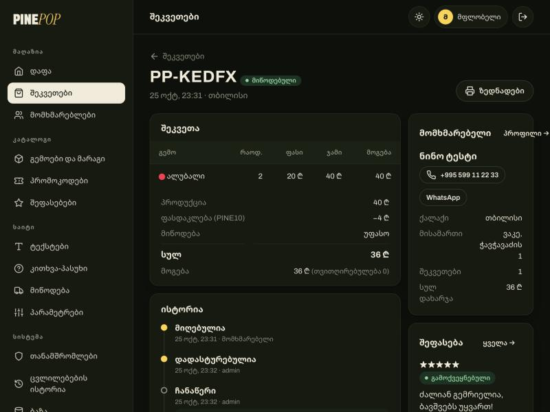

<div align="center">

# PINE*POP* 🍍

Fresh-cut pineapple tossed in Kool-Aid powder, sold by the jar — a one-page Georgian shop
where a 3D glass jar tells the whole story as you scroll, and a staff dashboard that runs
the business behind it.

ქართული  ·  Three.js  ·  GSAP + Lenis  ·  Node.js + Express 5  ·  PostgreSQL (PGlite locally)  ·  Vite

[Screenshots](#screenshots) · [Quick start](#quick-start) · [The dashboard](#the-dashboard) · [Roadmap](PLAN.md)


</div>

---

> **Work in progress.** The storefront, checkout, database and dashboard all work; online card
> payments, the logo and deployment are still ahead — see [PLAN.md](PLAN.md).
> *Kool-Aid* is a registered trademark of Kraft Heinz. It appears here only as an ingredient;
> the brand is PINEPOP, and nothing in the code hardcodes even that — it is a setting.

PINEPOP is a small food business with a big-studio website. The visual language borrows from
two very different references: the single morphing glass object of
[polpharmabiologics.com](https://www.polpharmabiologics.com/) and the oversized type,
topographic lines and kinetic marquees of [landonorris.com](https://landonorris.com/).

There are no 3D model files in this repository. The jar, its label, the screw lid, every
pineapple chunk inside it and every whole pineapple floating around it are built from code
at load time.

**Everything on screen is read from the database.** Every sentence on the page, the shop's
name, the flavours and their colours, prices, stock, the jar size and shelf life, delivery
zones with their own prices, coupons, the FAQ, the reviews, phone and social links — all of it
is edited from the dashboard. There is nothing a shop owner would ever need to change in the code.

---

## Contents

- [Screenshots](#screenshots)
- [What's on the page](#whats-on-the-page)
- [Quick start](#quick-start)
- [The database](#the-database)
- [The dashboard](#the-dashboard)
- [Accounts and roles](#accounts-and-roles)
- [How the 3D works](#how-the-3d-works)
- [Orders and money](#orders-and-money)
- [API](#api)
- [The data model](#the-data-model)
- [Security](#security)
- [Project structure](#project-structure)
- [Known limits](#known-limits)

---

## Screenshots

| | |
| --- | --- |
|  |  |
| **The process.** Scroll drives it: the lid lifts, fresh yellow chunks drop in, powder falls and the chunks change colour, the lid closes. | **Flavours.** Picking one recolours the chunks, the lid, the label and the accent of the whole page. |
|  |  |
| **Dashboard.** Revenue, orders, profit, visitors and conversion against the previous period; light and dark themes. | **An order.** Items as priced that day, coupon, delivery, profit, the customer, and every status change and note. |

---

## What's on the page

| Section | What happens |
| --- | --- |
| **Loader** | Counter and wordmark while fonts load and shaders compile, then a wipe into the hero. |
| **Hero** | Giant wordmark behind the jar, floating pineapples, mouse-follow tilt. |
| **Statement** | A sentence lights up word by word, a hand-drawn line draws itself, stats count up. |
| **Process** | A pinned, scroll-scrubbed three-step story: cut → sprinkle → seal. Titles rise letter by letter. |
| **Marquee** | Two rows of type whose speed, direction and lean follow your scroll. |
| **Flavours** | Pick a flavour; the 3D jar and the page accent change colour. |
| **Shop** | Quantity per flavour, live total, buy button → checkout with delivery zone and promo code. |
| **Reviews** | Published reviews from delivered orders, with the shop's replies. Absent until there is one. |
| **FAQ** | Questions and answers from the dashboard. |
| **Order status** | Order number + phone → where the order is; after delivery, the place to leave a review. |
| **Footer** | Wordmark, contacts and social links (only the ones that are filled in). |

Phones get their own jar poses, a full-screen menu, backed cards over the 3D, and a lighter scene.

---

## Quick start

**You need** Node 22.13 or newer (built and tested on Node 26). **No database to install** —
locally the shop runs on [PGlite](https://pglite.dev), a full PostgreSQL compiled to WebAssembly
that keeps its files in `data/pglite`.

```bash
git clone https://github.com/tornikepe/pinepop.git
cd pinepop
npm install
cp .env.example .env
```

Open `.env` and set `ADMIN_PASSWORD` (10+ characters). Then:

```bash
npm run dev
```

The shop is at `http://localhost:3000`, the dashboard at `/admin`. One process serves both:
Express runs the API and mounts Vite in middleware mode, so hot reload works for the front end.

On the first start the schema is created, the shop is filled with four flavours, a delivery
zone and five FAQ entries, and the first staff account is made from `.env`.

**Production**

```bash
npm run build
npm start
```

**Lost the password?** Stop the server, then:

```bash
npm run admin:reset -- admin
```

It prints a new password once and signs that account out everywhere.

---

## The database

PostgreSQL everywhere — the same SQL locally and in production:

| Where | What runs | How |
| --- | --- | --- |
| Your computer | **PGlite** (Postgres 18 in WebAssembly) | nothing to set — files in `data/pglite` |
| A server | **Any PostgreSQL** — Supabase, Neon, your own | set `DATABASE_URL` in `.env` |

`server/db/index.js` gives the rest of the server one small interface over both drivers
(`query`, `one`, `tx`). The schema lives in numbered SQL files in `server/db/migrations/` and is
applied on start; a change to the schema is a new file, never an edit to one that has shipped.

**Coming from the first version?** It kept everything in SQLite (`data/pinepop.db`). On the first
start with an empty Postgres, that file is read and everything moves across — flavours, prices,
stock, orders, settings and the admin login (its hash is the same scrypt format). The SQLite file
is left untouched.

**Backups:** Dashboard → ბაზა → სარეზერვო ასლი downloads every table as one JSON file.

---

## The dashboard

`/admin`, staff only. Fourteen pages, light and dark themes, works on a phone.

| Page | What it is for |
| --- | --- |
| **დაფა** — Home | Today's takings, orders waiting, low stock, reviews to moderate; revenue, orders, profit, jars, visitors and conversion for 7 / 30 / 90 days against the period before; revenue and visitors by day; flavours by jars sold. |
| **შეკვეთები** — Orders | Filter by status and date, search by code, name, phone or address, export CSV. One order: items as they were priced that day, coupon, delivery, profit, the customer, WhatsApp and call buttons, the full history with staff notes, a printable invoice. One button moves it to the next step; cancelling puts the jars back on the shelf. |
| **მომხმარებლები** — Customers | Everyone who ordered, grouped by phone number: orders, money spent, favourite flavours, a private note. CSV export. |
| **გემოები და მარაგი** — Flavours & stock | Name, description, colour (it tints the 3D jar), price, **cost price**, low-stock warning, order on the page, on/off. Restock or correct the count — every change is a movement with the balance after it. Sold, revenue, profit and margin per flavour. |
| **პრომოკოდები** — Coupons | Percentage or fixed, minimum order, expiry, usage cap, on/off; how often each was used and how much it gave away. |
| **შეფასებები** — Reviews | Moderation: publish, hide, reply publicly, delete. |
| **ტექსტები** — Texts | Every sentence on the storefront, grouped by section, with `{brand}` for the shop name. An empty field restores the original. |
| **კითხვა-პასუხი** — FAQ | The questions on the page, their order and visibility. |
| **მიწოდება** — Delivery | Zones (a city or a district), each with its own price, a "free from" amount and a delivery time. |
| **პარამეტრები** — Settings | Brand name, jar size, shelf life, pausing orders (with the message shown), minimum order, jars per flavour, reviews on/off, contacts and social links. |
| **თანამშრომლები** — Staff | Accounts, roles, last sign-in, active sessions, password age; invite with a generated password, reset a password, disable, delete. |
| **ცვლილებების ისტორია** — Audit | Who changed what, and what it was before. |
| **ბაზა** — Database | Which database, where, how big, rows per table, migrations, and the JSON backup. |
| **ჩემი ანგარიში** — Account | Your login, name and password. |

Charts follow one rule set: a single colour per chart, validated for contrast in both themes,
4px rounded caps, a hover/focus tooltip per day and a table view with the same numbers.

---

## Accounts and roles

| Role | Can |
| --- | --- |
| **ადმინი** — admin | Everything. |
| **მენეჯერი** — manager | Orders, customers, stock and flavours, review moderation. Not staff, settings, texts, coupons, audit or the database. |
| **მნახველი** — viewer | Sees the dashboard pages, changes nothing. |

Roles are enforced on the server for every request — hiding a button hides nothing. The first
account comes from `ADMIN_USER` / `ADMIN_PASSWORD`, once; after that `.env` is not read for it.
Lowering someone's role or disabling them signs them out immediately. The last active admin
cannot be removed or demoted.

---

## How the 3D works

All of it is in `src/scene/`, plain Three.js, no loaders.

- **The light** (`studio.js`) is a dark photo studio with a few bright softboxes, baked into
  an environment map — that is what gives the glass its vertical highlight streaks.
- **The jar** (`jar.js`) is a lathed profile with a physically based glass material
  (transmission, IOR 1.5, clearcoat). The label is a canvas texture redrawn whenever the
  flavour, the brand or the jar size changes. The lid is a cylinder with a knurled edge pushed
  out of its vertices.
- **The chunks** are one `InstancedMesh` of bevelled tidbits cut from a pineapple ring, paler
  towards the core — several hundred of them in a single draw call. Each has its own drop-in
  timing, so the jar can empty and refill bottom-up, and its own share of powder coating.
- **The powder** is a point cloud that spirals down into the open jar during step two.
- **The pineapples** (`pineapple.js`) are a lathed body whose surface is pushed out in a spiral
  diamond lattice (the "eyes"), vertex-coloured, with a crown of creased, curling leaves.
- **Scroll → scene** (`scroll.js`): every section carries `data-pose="x,y,scale,rotation"`
  (`data-pose-m` for phones). The jar holds a section's pose while that section fills the
  screen and eases to the next one in between. The process section's progress drives lid,
  fill, powder and coating as pure functions — scrolling back up replays it exactly.

Changing the flavour blends the colour over half a second while the jar makes one quick turn.
Scroll speed tilts the jar, spins the pineapples faster and skews the marquee.

---

## Orders and money

- **Money is integer tetri** (1 ₾ = 100 tetri) everywhere in the database.
- **An order is a snapshot**: flavour names, prices, costs, the delivery zone, the coupon and
  the discount are copied onto it when it is placed, so an invoice printed next year says what
  was actually sold.
- **The server prices everything.** Prices, the coupon, the zone fee and "free from" are
  recomputed when the order arrives; the browser's totals are only a preview.
- **Stock** is taken in the same transaction as the order, with the product rows locked, so two
  customers cannot both buy the last jar. Cancelling returns it; un-cancelling takes it again.
- **Coupons**: percentage or fixed, never more than the goods; expiry, minimum and usage cap are
  checked at the moment of the order, and a cancelled order gives its use back.
- **Orders can be paused** from Settings — the buy button then shows the shop's own message.
- Payment is cash or card **on delivery** for now. Online payment is stage 4 of the plan.

---

## API

| Method | Path | |
| --- | --- | --- |
| `GET` | `/api/site` | Settings, texts, flavours, delivery zones, FAQ and published reviews — everything the storefront needs. |
| `POST` | `/api/orders` | Place an order. Rate-limited per IP. |
| `POST` | `/api/coupons/check` | Is this code valid for this basket, and what does it take off. |
| `POST` | `/api/track` | Order status by code + phone. |
| `POST` | `/api/reviews` | Review a delivered order (code + phone), once. |
| `POST` | `/api/visit` | Count a visit (no cookie). |
| `GET` | `/api/health` | `{ ok, db, ms }` for an uptime monitor. |
| `POST` | `/api/admin/login` · `/logout` | Session cookie (HttpOnly, SameSite=Strict). |
| `GET` · `PUT` | `/api/admin/me` · `/account` | Who is signed in · change own login, name, password. |
| `GET` | `/api/admin/dashboard?days=` | Everything on the home page. |
| `GET` · `PATCH` · `POST` | `/api/admin/orders` · `/:id` · `/:id/status` · `/:id/notes` · `orders.csv` | Orders. |
| `GET` · `PATCH` | `/api/admin/customers` · `/:id` · `customers.csv` | Customers. |
| `GET` · `POST` · `PUT` · `DELETE` | `/api/admin/products` · `/:id` · `/:id/stock` · `/:id/movements` | Flavours and stock. |
| `GET` · `POST` · `PUT` · `DELETE` | `/api/admin/coupons` · `/zones` · `/faqs` (`/:id`) | Coupons, delivery zones, FAQ. |
| `GET` · `PATCH` · `DELETE` | `/api/admin/reviews` · `/:id` | Moderation. |
| `GET` · `PUT` | `/api/admin/content` · `/settings` | Texts and settings, validated per field. |
| `GET` · `POST` · `PATCH` · `DELETE` | `/api/admin/staff` · `/:id` · `/:id/password` | Staff (admin only). |
| `GET` | `/api/admin/audit` · `/database` · `/database/backup` | Audit log, database info, JSON backup (admin only). |

---

## The data model

17 tables in `server/db/migrations/001_init.sql`.

- **Catalogue** — `products`, `stock_movements`
- **Selling** — `orders`, `order_items`, `order_events`, `coupons`, `delivery_zones`
- **People** — `customers`, `reviews`, `staff`, `sessions`
- **The shop itself** — `settings`, `content`, `faqs`, `meta` (internal values, never sent to a browser)
- **Counting** — `visits`, `audit_log`

---

## Security

- **Passwords**: scrypt with a per-account salt; never logged or returned. New and reset
  passwords are generated with `crypto.randomBytes` and shown once.
- **Sessions**: a random 256-bit token in an HttpOnly, SameSite=Strict cookie; only its SHA-256 is
  stored. Logout deletes it; a password change signs out every other device.
- **Rate limits** on sign-in (per address *and* per account), orders, coupon checks, tracking and
  reviews.
- **Authorisation is on the server**, per route and per role.
- **Order tracking** needs the code *and* the phone it was placed with; a wrong one of either
  answers the same, so codes cannot be probed.
- **Visitors are counted without cookies**: a daily salted hash of address and browser that
  cannot be turned back into a person.
- **Audit trail**: every staff change is written with its before and after.
- Everything from the database is escaped before it reaches a page; links in settings must be
  `http(s)`. `.env` and the database files are git-ignored.

---

## Project structure

```
index.html              storefront markup (default copy; the dashboard overrides it)
src/
  main.js               boot, loader, intro, smooth scroll
  content.js            puts texts, settings, reviews and FAQ into the page
  shop.js               flavour picker, quantities, checkout (zones, coupons)
  track.js              order status + review form
  drawer.js             side panels
  scroll.js             scroll → jar poses, process scene, text animations, marquee
  menu.js · cursor.js · topo.js · styles.css
  scene/                Three.js: Scene, jar, pineapple, studio light
server/
  index.js              Express app, Vite in dev / static in prod
  public.js             storefront API
  auth.js               sign-in, sessions, roles, own account
  audit.js              audit log helper
  settings.js           settings schema + validation
  content.js            every site text, with defaults
  admin/                dashboard API: stats, orders + customers, catalogue, site, system
  db/                   connection (PGlite / Postgres), migrations, seed, SQLite import
  scripts/              admin:reset
admin/
  index.html · admin.css
  js/app.js             router, layout, session
  js/core.js            API, formatting, icons, modals, toasts
  js/charts.js          column chart, ranked bars
  js/pages/             one file per dashboard page
docs/screenshots/       images used in this README
PLAN.md                 the roadmap, in Georgian
AGENTS.md               notes for AI coding agents working on this repo
```

---

## Known limits

- **Not deployed yet.** Locally the database is PGlite; on a server set `DATABASE_URL`. The
  Express server needs a Node host (Railway, Render, a VPS).
- **No online payment** — cash or card on delivery only.
- **No email or SMS** yet — new orders are seen in the dashboard (a Telegram alert is planned).
- **Rate limits live in memory** and reset when the server restarts.
- **Georgian only** on the storefront.
- **No automated tests yet.**
- **No logo yet** — the wordmark is set in type.

<div align="center">

---

Made in Georgia 🍍

</div>
